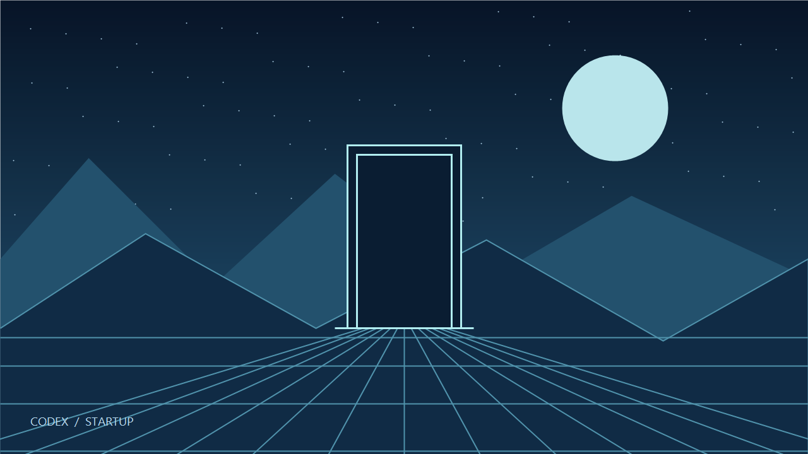

# Codex Startup Animation · Windows

给 Windows 上的 Codex 桌面应用添加自定义启动动画和静态壁纸。支持视频和图片素材：碎线逐条聚拢成线稿，画面在线稿下方亮起、线稿随之散开，最后平滑落到 Codex 壁纸上。线稿和强调色取自素材本身。

这是基于 [panding999/codex-startup-animation](https://github.com/panding999/codex-startup-animation) 改造的非官方 Windows 外部启动器。来源及授权状态见 [NOTICE.md](NOTICE.md)。



## 快速开始

1. 下载 [Releases](https://github.com/Janson14332/codex-startup-animation-windows/releases) 中的 ZIP 并完整解压到固定目录。
2. 安装 **Node.js 22+**。自定义素材还需要 **FFmpeg**（包含 `ffprobe`）。
3. 双击 **安装项目.cmd**，初始化示例并创建桌面上的启动、预览、更换素材三个快捷方式。
4. 双击桌面 **Codex 更换启动素材** 选择自己的视频、GIF 动图或图片，再打开 **Codex 动画预览** 查看。
5. 完全退出 Codex（包括系统托盘后台进程），再双击桌面 **Codex 启动动画**。

Windows 10/11；正式启动依赖官方 `OpenAI.Codex` MSIX 应用。只看预览无需安装 Codex。Node.js 和 FFmpeg 可通过下列命令安装，完成后重新打开终端：

```powershell
winget install --id OpenJS.NodeJS.LTS -e
winget install --id Gyan.FFmpeg -e
```

移动项目目录后，重新双击「安装项目.cmd」更新桌面快捷方式。桌面「Codex 启动动画」完全隐藏运行，不显示命令行窗口；启动失败时会弹窗说明原因（同时写入 `.build/last-launch.log`）。需要看完整过程时运行「扩展启动Codex.cmd」。更新项目后请重新运行「安装项目.cmd」，桌面快捷方式才会改为隐藏方式。

## 自定义素材

双击 **更换素材.cmd** 选择文件，或把文件拖到 **更换素材.cmd / 更新动画.cmd** 上。

| 素材 | 支持格式 | 播放效果 | 壁纸 |
| --- | --- | --- | --- |
| 视频 | MP4、MOV、M4V、MKV、WebM、AVI，1–120 秒 | 原线稿动画后完整播放；静音，保留原始帧时间 | 最后一帧 |
| 图片 | PNG、JPG、JPEG、WebP、BMP | 在线稿下方渐亮，默认 2 秒 | 所选图片 |
| GIF 动图 | GIF | 转为静音视频，在线稿下方循环播放，整遍循环到至少 4 秒（`gifSeconds`）；单帧 GIF 按图片处理 | 最后一帧 |

画面居中放入 1280×720 的 16:9 画幅，不拉伸；比例不符时两侧用同一画面的模糊暗化版本填充，不再出现黑边，线稿也不会描出画幅边界。WebP 等其他动态图片仍只使用第一帧；动态效果请用 GIF 或视频。转换后的视频上限为 40 MB。

图片渐亮时长可在 `素材/素材设置.json` 中修改 `imageDurationSeconds`（1–120 秒），GIF 最短播放时长修改 `gifSeconds`（1–120 秒，按整遍循环），再双击「更新动画.cmd」。配置中的 `file` 记录当前源文件，覆盖该文件后运行更新也可以替换素材。两类源文件可共存，选择或拖入文件即可切换。

预览和正式启动共用项目素材，修改后刷新预览；已运行的 Codex 需退出后重新启动。动画播放中点击画面任意处或按 Esc 可跳过；系统开启「减少动态效果」时只做约 1 秒的淡入淡出。动画结束后按 **Ctrl+Alt+B** 打开当前环境的图片与壁纸设置（含壁纸显现程度与画面焦点）。该设置只保存在当前浏览器或 Codex 的 IndexedDB；要同步两边，请使用桌面更换素材入口。

## 源码与开发

项目没有 npm 运行时依赖。首次克隆后执行：

```powershell
npm run setup
npm test
npm run test:media
npm run package
```

`test:media` 需要 FFmpeg，验证图片与视频切换、错误输入、图片模式不依赖视频，以及变帧率素材的逐帧时间。`FFMPEG_BIN`、`FFPROBE_BIN` 可指定完整程序路径。

`npm run package` 输出 `dist/codex-startup-animation-windows-v1.1.0.zip` 和 SHA-256 校验文件。发布包始终使用中性示例素材，按明确文件清单打包，不包含 `.git`、本机配置、日志和个人图片或视频。「更新动画.cmd」更新素材后也会重新生成这份示例发布包。

```text
animation.js, style.css, index.html  动画与预览
extension/                          Windows 接入与静态壁纸
tools/                              素材生成、初始化、安装、测试、打包
examples/                           可复现的中性示例图片与预生成线稿
assets/                             本机生成文件（Git 忽略）
素材/                               本机源素材与配置（Git 忽略）
docs/                               故障处理与实现说明
```

## 兼容性与恢复

启动器核对官方 MSIX 身份与发布者，通过仅绑定 `127.0.0.1` 的调试端口接入官方主窗口；不会修改官方安装包。动画结束移除覆盖层，保留静态壁纸。官方应用升级可能改变窗口结构或调试行为，需要相应适配。

本机调试端口会随该次官方应用进程存活。完全退出 Codex，再从官方图标正常启动可关闭端口并停止扩展启动；设置内「关闭美化，恢复 Codex 外观」可移除当前壁纸与覆盖层。详见 [故障处理](docs/TROUBLESHOOTING.md)。

自动化检查不代表已在所有 Codex 版本和显示设备上验证冷启动或实际流畅度。
